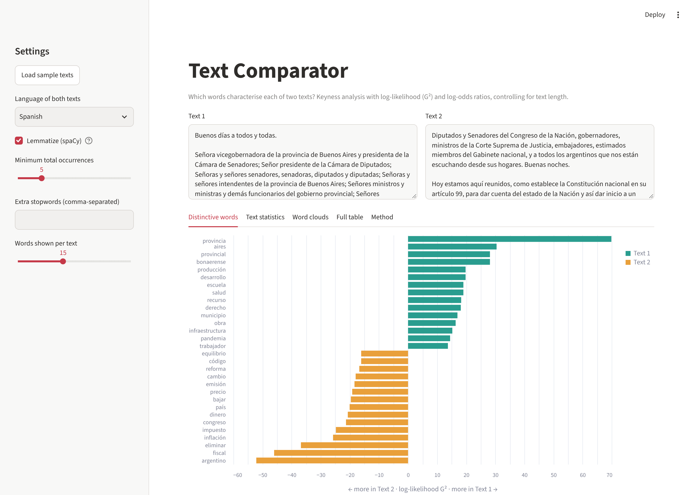
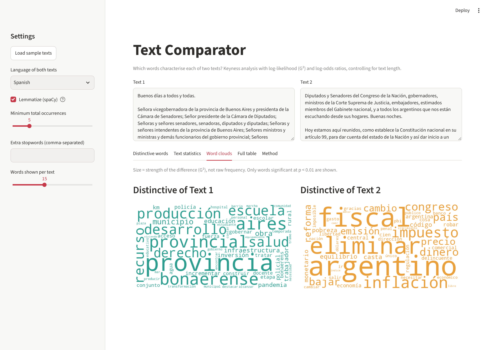

# Text Comparator: Which Words Characterise Each Text?

Streamlit app that compares the vocabulary of two texts (Spanish or English) and shows the words that are statistically more typical of one than of the other (**keyness analysis**), together with basic stylistic measures. It controls for text length, which a plain frequency comparison does not.

**[Live app →](https://textcomparator-9w7v.onrender.com/)** (free hosting: the first load after inactivity can take about a minute)



## What it does

- **Distinctive words:** ranks words by log-likelihood (G²) and shows which text each belongs to.
- **Log-odds z-score** with an informative Dirichlet prior (Monroe, Colaresi & Quinn, 2008), so rare words do not dominate the ranking.
- **Rates per 1,000 tokens**, so texts of different length are comparable.
- **Text statistics:** content words, distinct words, lexical diversity (MATTR, independent of length) and average sentence length.
- **Word clouds sized by G²** (strength of difference), not raw frequency.
- Optional **lemmatization** with spaCy, custom stopwords, adjustable frequency threshold and CSV export.



## Example

The sample texts (`data/sample_*.txt`) are two Spanish-language political speeches of different length: an address to a provincial legislature (about 16,300 words) and an address to a national congress (about 8,200 words).

| | Text 1 | Text 2 |
|---|---|---|
| Content tokens after lemmatization | 7,053 | 3,265 |
| Lexical diversity (MATTR-500) | 0.681 | 0.682 |
| Average sentence length (words) | 21.6 | 25.7 |

Most distinctive lemmas: *provincia* (G² = 69.9), *provincial*, *bonaerense*, *escuela*, *producción* for Text 1; *argentino* (G² = 52.2), *fiscal*, *eliminar*, *inflación*, *impuesto* for Text 2.

The lexical-diversity scores are almost identical, and the distinctive words mainly reflect **setting and topic** (provincial services versus national economic policy). Keyness shows what differs in vocabulary; it does not by itself show intent or style.

## Run locally

```bash
git clone https://github.com/Nicolakorff/TextComparator.git
cd TextComparator
python -m venv .venv && source .venv/bin/activate   # Windows: .venv\Scripts\activate
pip install -r requirements.txt
streamlit run app.py
pytest
```

`requirements.txt` installs the spaCy models for Spanish and English. Without them the app still works, with lemmatization disabled.

## Method in brief

| Step | Detail |
|---|---|
| Tokens | Alphabetic words, lowercased, spaCy stopword lists; optional lemmatization |
| Rate | Occurrences per 1,000 content tokens |
| G² | Dunning's log-likelihood; 6.63 ↔ p < 0.01, 15.13 ↔ p < 0.0001 (1 d.f.) |
| Log-odds z | Log-odds ratio with informative Dirichlet prior |
| MATTR | Moving-average type/token ratio, window 500 |

## Repository structure

```
├── app.py                    # Streamlit interface
├── textcomparator/analysis.py  # tokenization, keyness, statistics
├── tests/                    # unit tests and an app smoke test
├── data/                     # sample texts
├── docs/                     # screenshots
├── render.yaml               # Render deployment
└── requirements.txt
```

## Limitations

- **Both texts must be in the same language** (Spanish or English); comparing across languages is not meaningful.
- With hundreds of words tested, some false positives are expected: p-values are **not corrected** for multiple comparisons, so use the ranking as exploratory.
- Results depend on stopword lists and lemmatization; spaCy's small models make some lemmatization errors.
- Differences reflect topic and occasion as much as style, and the sample comparison involves only two texts.
- Single words only: no phrases (n-grams) or collocations yet.

## Next steps

- N-grams and collocations; keyness by part of speech.
- Bootstrap confidence intervals and multiple-comparison correction.
- More languages (German, Catalan).

## Author

**Nicola Korff** · [LinkedIn](https://www.linkedin.com/in/nicola-korff/) · [GitHub](https://github.com/Nicolakorff)
